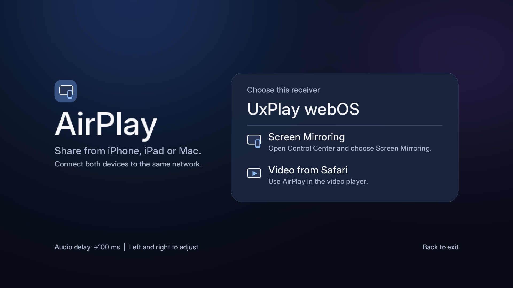
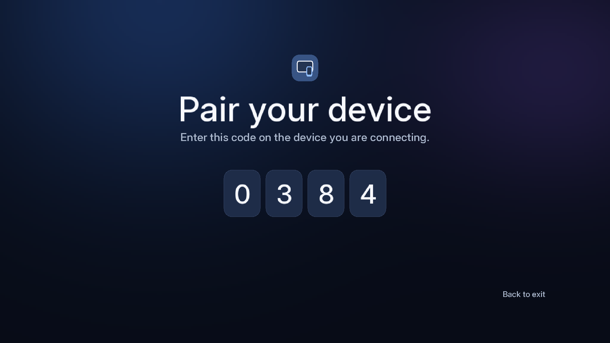
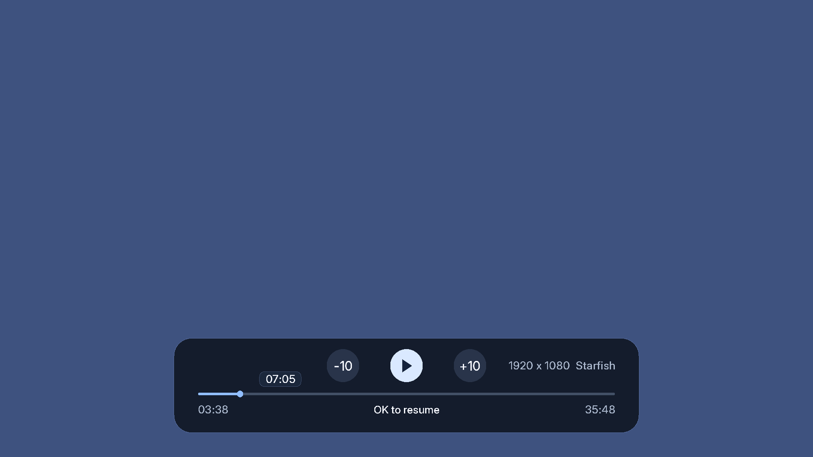

# UxPlay webOS Legacy

**English** · [Русский](README.ru.md)

An AirPlay receiver for older LG TVs. This fork is developed independently for the **LG 55LB680V-ZD with webOS 1.4 (Rockhopper, ARMv7)**. One receiver, **UxPlay webOS**, handles screen mirroring and direct video playback from Safari.

- Screen mirroring with audio and PIN pairing.
- Direct H.264 MP4 and HLS playback with Starfish hardware decoding on compatible streams. LGNC and software decoding are available as fallbacks.
- Pause, skip, timeline seeking with a time preview, and HLS quality selection. Supports directional keys and the Magic Remote pointer.
- Direct playback stops when the active AirPlay event connection closes.

Compatibility was tested on the model above. Direct playback depends on the source format, codec, and server. Protected streams and every Safari player are outside the tested scope. The UI is in English.

## Screenshots

These are local captures rendered by the application. The PIN and player background are examples.

| Receiver | Pairing | Player |
| --- | --- | --- |
|  |  |  |

## Install

Download the ARM IPK from [Releases](https://github.com/ElebrUS/uxplay-webos/releases). Use a rooted compatible TV with a configured webOS CLI target. Back up the current app before updating.

```bash
ares-install -d <device> com.github.danlflh.uxplaywebos_<version>_arm.ipk
ares-launch -d <device> com.github.danlflh.uxplaywebos
```

Connect the TV and sender to the same network. On iPhone or Mac, choose **UxPlay webOS** from Screen Mirroring or from the AirPlay menu in a compatible Safari video player.

## Build and release

Use macOS on Apple Silicon with CMake, Ninja, pkg-config, Python 3, and the [webOS CLI](https://webostv.developer.lge.com/develop/tools/cli-installation). Run `tools/build.sh` for the ARMv7 IPK and `python3 tools/source-package.py` for the corresponding source archive. Builds use dependencies pinned in [dependencies.lock.json](dependencies.lock.json).

GitHub Actions runs host tests, validates the metadata, and produces build artifacts. A matching version tag publishes the IPK, corresponding source, and SHA-256 checksums. See [Releasing](docs/RELEASING.md), [webOS 1.4 notes](docs/WEBOS14.md), and the [changelog](CHANGELOG.md).

## Credits and license

Thanks to **Daniel Filho** for the original [UxPlay webOS port](https://github.com/danlflh/uxplay-webos) and to the [FDH2/UxPlay contributors](https://github.com/FDH2/UxPlay) for the AirPlay receiver core. The fork keeps the original application ID for in-place updates. It follows its own release history without automatic synchronization from the parent repository.

[GPL-3.0-or-later](LICENSE) · [Third-party components](THIRD_PARTY.md)
