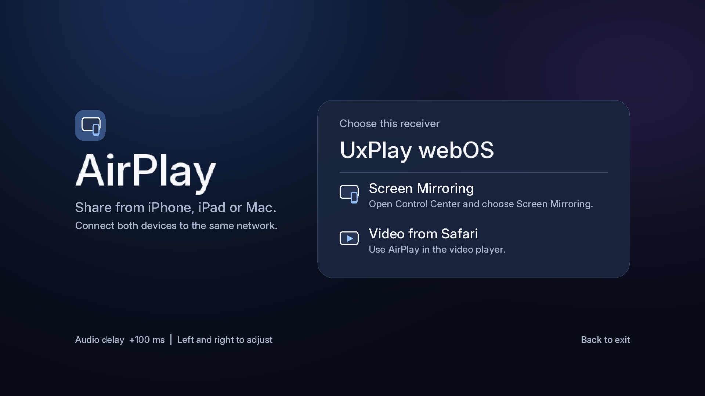
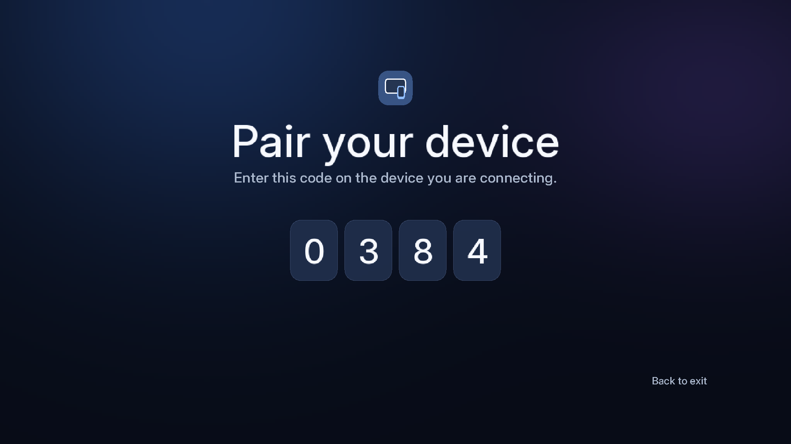
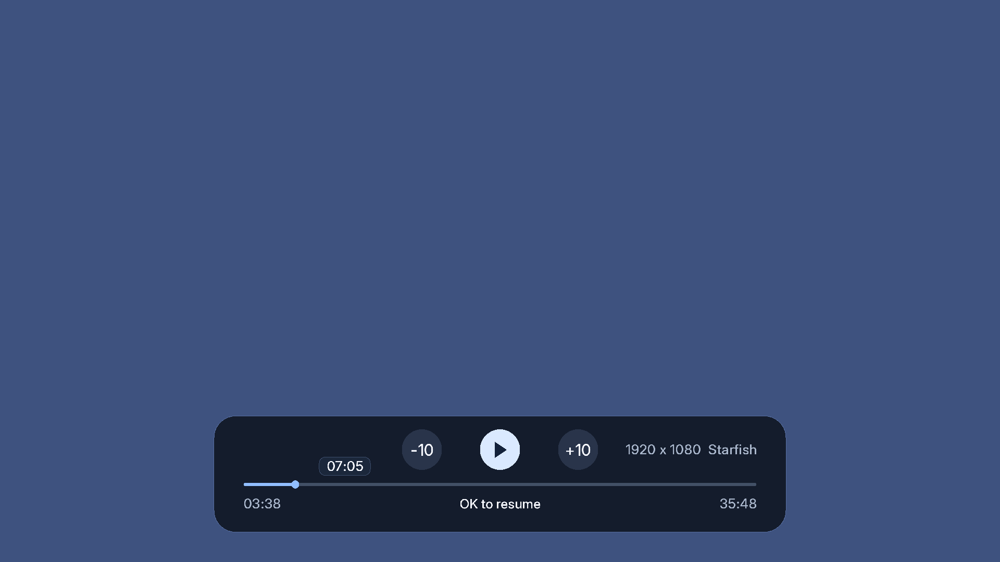

# UxPlay webOS Legacy

[English](README.md) · **Русский**

Приёмник AirPlay для старых телевизоров LG. Форк развивается самостоятельно для **LG 55LB680V-ZD с webOS 1.4 (Rockhopper, ARMv7)**. Один приёмник **UxPlay webOS** поддерживает повтор экрана и прямое воспроизведение видео из Safari.

- Повтор экрана со звуком и сопряжение по PIN.
- Прямое воспроизведение H.264 MP4 и HLS через Starfish для совместимых потоков. Доступны резервные пути через LGNC и программный декодер.
- Пауза, короткие прыжки, перемотка по шкале с предпросмотром времени и выбор качества HLS. Поддерживаются кнопки и указка Magic Remote.
- При закрытии канала событий активного сеанса AirPlay прямое видео останавливается.

Совместимость проверяли на указанной модели. Прямое воспроизведение зависит от формата, кодека и сервера. Защищённые потоки и работа со всеми плеерами Safari выходят за рамки проверенных сценариев. Интерфейс на английском языке.

## Скриншоты

Экраны отрисованы приложением локально. PIN и фон плеера демонстрационные.

| Приёмник | Сопряжение | Плеер |
| --- | --- | --- |
|  |  |  |

## Установка

Скачайте ARM IPK из раздела [Releases](https://github.com/ElebrUS/uxplay-webos/releases). Нужен совместимый телевизор с root-доступом, настроенный в webOS CLI. Перед обновлением сохраните резервную копию текущего приложения.

```bash
ares-install -d <устройство> com.github.danlflh.uxplaywebos_<версия>_arm.ipk
ares-launch -d <устройство> com.github.danlflh.uxplaywebos
```

Подключите телевизор и отправитель к одной сети. На iPhone или Mac выберите **UxPlay webOS** в меню повтора экрана или меню AirPlay совместимого видеоплеера Safari.

## Сборка и выпуск

Нужен Mac с Apple Silicon, CMake, Ninja, pkg-config, Python 3 и [webOS CLI](https://webostv.developer.lge.com/develop/tools/cli-installation). Скрипт `tools/build.sh` собирает ARMv7 IPK, а `python3 tools/source-package.py` готовит архив исходников. Версии зависимостей закреплены в [dependencies.lock.json](dependencies.lock.json).

GitHub Actions запускает локальные тесты, проверяет метаданные и собирает артефакты. Тег версии публикует IPK, исходники и контрольные суммы SHA-256. См. [порядок выпуска](docs/RELEASING.md), [заметки по webOS 1.4](docs/WEBOS14.md) и [журнал изменений](CHANGELOG.md).

## Авторы и лицензия

Спасибо **Даниэлю Филью** за оригинальный [порт UxPlay для webOS](https://github.com/danlflh/uxplay-webos) и [разработчикам FDH2/UxPlay](https://github.com/FDH2/UxPlay) за ядро приёмника AirPlay. Форк сохраняет оригинальный ID приложения для обновления поверх установленной версии. Релизы ведутся отдельно, без автоматической синхронизации с родительским репозиторием.

[GPL-3.0-or-later](LICENSE) · [Сторонние компоненты](THIRD_PARTY.md)
